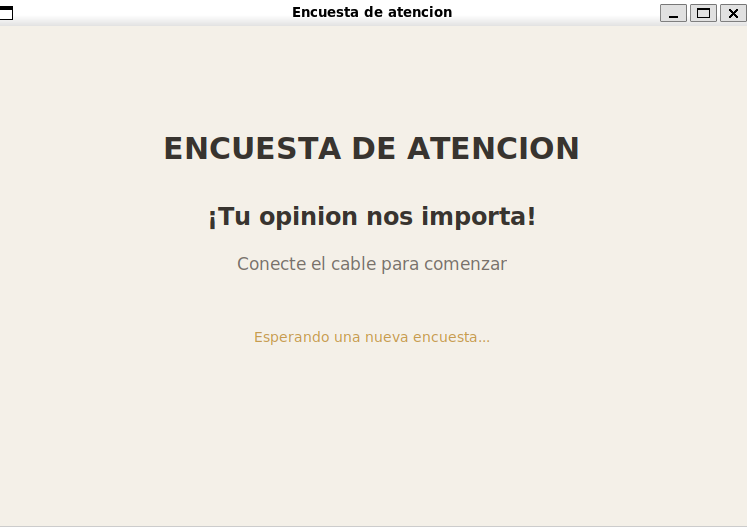
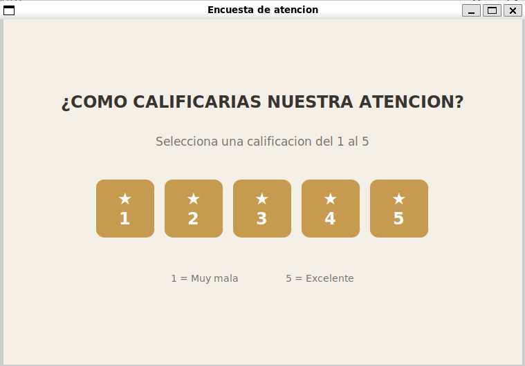
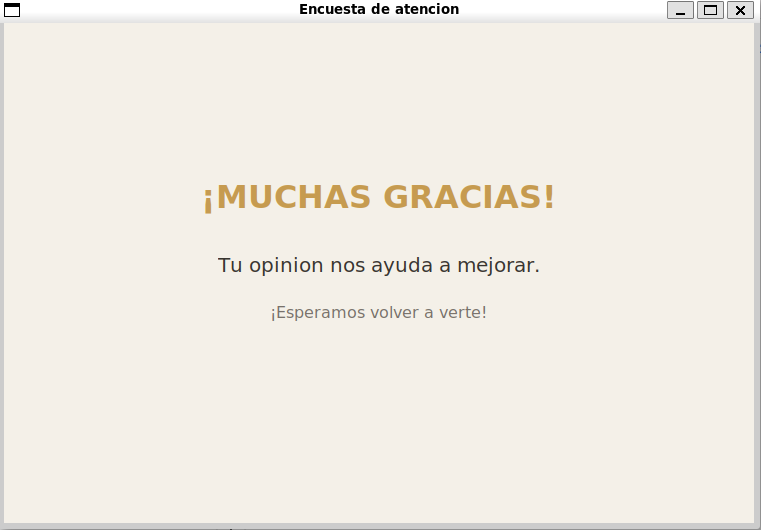
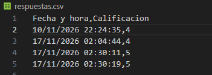

# Customer Experience

**Institución:** ITS Villada  
**Docentes:** Facundo Bisio y Luciano Cortesini  
**Integrantes:** Gambino, Molina y Sahonero  
**Fecha de entrega:** 18/11/2026 – 25/11/2026

---

## 1. Descripción del proyecto

Customer Experience es un sistema de calificación de experiencias que permite a una persona valorar un servicio mediante una interfaz gráfica sencilla e intuitiva.

El proyecto utiliza un Arduino conectado a una computadora para detectar el inicio de una encuesta y controlar un LED indicador. La interfaz, desarrollada en Python, permite seleccionar una calificación de una a cinco estrellas y almacena las respuestas en un archivo CSV.

### Funcionamiento

1. El sistema permanece en una pantalla de espera.
2. El usuario conecta un cable puente entre el pin digital D2 y GND del Arduino para iniciar la encuesta.
3. El Arduino detecta la conexión, enciende el LED verde y envía la señal `INICIO` a Python.
4. La interfaz muestra la encuesta con cinco opciones de calificación.
5. El usuario selecciona una cantidad de estrellas.
6. Python registra la fecha, la hora y la calificación en un archivo CSV.
7. Python envía la señal `FIN` al Arduino, que apaga el LED verde.
8. La interfaz muestra un mensaje de agradecimiento y luego vuelve a la pantalla de espera.

El sistema espera a que el cable puente sea desconectado antes de permitir un nuevo inicio.

## 2. Interfaz gráfica

La aplicación cuenta con tres pantallas principales, desarrolladas con la biblioteca CustomTkinter.

### Pantalla de espera

Es la pantalla inicial del sistema. Permanece visible hasta que el Arduino detecta la conexión del cable puente.

**Captura:**



### Pantalla de encuesta

Muestra cinco estrellas numeradas del 1 al 5. El usuario puede seleccionar una opción para registrar su valoración.

**Captura:**



### Pantalla de agradecimiento

Después de registrar la respuesta, se muestra un mensaje de agradecimiento. Luego de 2,5 segundos, la aplicación vuelve automáticamente a la pantalla de espera.

**Captura:**



## 3. Componentes utilizados

| Componente | Función |
|---|---|
| Arduino Uno | Controla el circuito y se comunica con Python. |
| LED verde | Indica que la encuesta está activa. |
| Resistencia de 220 Ω o 330 Ω | Limita la corriente que circula por el LED. |
| Cable puente | Permite iniciar el sistema conectando D2 con GND. |
| Cable USB | Conecta el Arduino con la computadora. |

### Conexiones

- **Pin D2:** se utiliza como entrada para detectar la conexión del cable puente.
- **GND:** se conecta con D2 mediante el cable puente para activar el sistema.
- **Pin D8:** controla el LED verde.
- **Resistencia:** se conecta en serie con el LED para limitar la corriente.

La entrada D2 utiliza la configuración `INPUT_PULLUP`, por lo que normalmente se encuentra en estado HIGH y pasa a LOW cuando se conecta a GND.

## 4. Comunicación Arduino-Python

La comunicación entre Arduino y Python se realiza mediante el puerto serie, utilizando una velocidad de transmisión de **9600 baudios**.

Se utilizan dos mensajes principales:

- `INICIO`: Arduino lo envía cuando detecta que el usuario conectó el cable puente. Python recibe el mensaje y muestra la encuesta.
- `FIN`: Python lo envía después de registrar la calificación. Arduino recibe el mensaje y apaga el LED verde.

Esta comunicación permite coordinar el funcionamiento del circuito físico con la interfaz gráfica.

## 5. Registro de respuestas

Cada calificación seleccionada se guarda automáticamente en el archivo `respuestas.csv`, ubicado dentro de la carpeta `python/`.

El archivo almacena dos datos:

- **Fecha y hora:** momento en el que se registró la respuesta.
- **Calificación:** cantidad de estrellas seleccionadas por el usuario.

De esta manera, las respuestas quedan guardadas para poder consultarlas posteriormente.

**Captura del registro:**



## 6. Tecnologías y bibliotecas

- **Arduino IDE:** programación y carga del código en Arduino.
- **Python:** desarrollo de la lógica de la aplicación.
- **CustomTkinter:** creación de la interfaz gráfica.
- **PySerial:** comunicación entre Arduino y Python.
- **CSV:** almacenamiento de las respuestas.

## 7. Instalación y ejecución

### Requisitos

- Tener instalado Python.
- Tener instalado Arduino IDE.
- Contar con un Arduino conectado a la computadora.
- Instalar las bibliotecas necesarias para Python.

### Instalación de bibliotecas

Desde una terminal, ubicarse en la carpeta `python/` y ejecutar:

```bash
pip install -r ../requirements.txt
```

### Ejecución

1. Abrir el archivo `arduino/encuesta.ino` con Arduino IDE.
2. Conectar el Arduino a la computadora mediante USB.
3. Seleccionar la placa y el puerto correspondiente.
4. Cargar el programa en el Arduino.
5. Verificar que el puerto configurado en `main.py` coincida con el puerto utilizado por el Arduino.
6. Ejecutar la aplicación desde la carpeta `python/`:

```bash
python main.py
```

7. Conectar el cable puente entre D2 y GND para iniciar una encuesta.

## 8. Cambios respecto al anteproyecto

Durante el desarrollo se realizaron modificaciones en el mecanismo de inicio del sistema. Inicialmente se había planteado utilizar un interruptor físico, pero se reemplazó por un cable puente conectado entre el pin D2 y GND del Arduino.

Este cambio permitió simplificar el circuito y mantener la funcionalidad prevista para el proyecto.

## 9. Estructura del repositorio

```text
calificador-de-experiencia/
│
├── arduino/
│   └── encuesta.ino
│
├── python/
│   ├── main.py
│   ├── interfaz.py
│   └── respuestas.csv
│
├── capturas/
│   ├── 01_standby.png
│   ├── 02_encuesta.png
│   ├── 03_agradecimiento.png
│   ├── 04_registro_respuestas.png
│   └── 05_circuito_arduino.png
│
├── anteproyecto.pdf
├── requirements.txt
└── README.md
```
